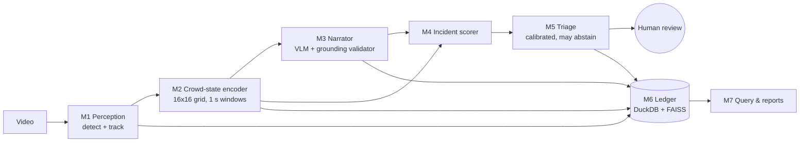

# Odin's Eye — Dense-Crowd Tracking & Grounded Scene Narration

[](https://github.com/NidaEsenn/Dense-Tracking/actions/workflows/ci.yml)


Offline analysis of recorded video from a single fixed camera watching a dense crowd.
Odin's Eye **measures first, then talks**: it tracks every person, turns the tracks into a
measured *crowd state* (count, density, flow, divergence per grid cell and second), and only
then lets a vision-language model describe the scene — with every number in the text linked
to a measured value.

> **Status:** Phase 1 (tracking + crowd-state measurement) is in progress, targeting
> December 2026. No results are reported yet; numbers will appear here only once they come
> from logged runs in `experiments/`.

## Why

Vision-language models miscount dense crowds, and their error grows with crowd size. Our
earlier prototype (v3) asked a VLM to describe single frames and found exactly that: counts and
motion were guessed from pixels, not measured. Odin's Eye instead conditions narration on
physical measurements from the tracker, and abstains when unsure.

## Pipeline



| Module | Role | Phase |
|---|---|---|
| M1 Perception | YOLO detection, tracker study (ByteTrack / BoT-SORT / Deep OC-SORT), MOTChallenge output | 1 |
| M2 Crowd-state encoder | Per-cell and global crowd features from tracks | 1 |
| M3 Narrator | Schema-constrained, grounded narration | 2 |
| M4–M5 Incidents & triage | Calibrated incident scores, abstention, draft reports | 4 |
| M6–M7 Ledger & query | Searchable logbook and on-demand reports | 2 |

## Roadmap

| Phase | Question | Experiments |
|---|---|---|
| **1. Measure the crowd** (Nov–Dec 2026) | How well can we track and measure crowd state in dense scenes? | E0 evaluation check, E1 tracker/ReID study, E2 crowd-state error |
| 2. Describe the crowd (Jan–Apr 2027) | Does measured crowd state make narration more faithful? | E3, E6 |
| 3. Build the benchmark (Apr–May 2027) | A public test set for dense tracking + incidents + grounded narration | — |
| 4. Detect and report (Jun–Nov 2027) | Can calibrated triage cut false alerts without missing incidents? | E4, E5 |

Evaluation uses the official TrackEval (HOTA, IDF1, MOTA, IDSW) on all four MOT20 training
sequences and CroHD, with distractor classes handled as in the official protocol.

## Quick start

```bash
git clone https://github.com/NidaEsenn/Dense-Tracking.git
cd Dense-Tracking
python -m venv .venv && source .venv/bin/activate
pip install -e ".[dev,video]"
pre-commit install
pytest
```

```python
from odins_eye.io import iter_frames, read_seqinfo

info = read_seqinfo("data/raw/MOT20/train/MOT20-01")  # fps read from seqinfo, never assumed
for idx, frame in iter_frames("data/raw/MOT20/train/MOT20-01"):  # streams, constant memory
    ...
```

## Repository layout

```
src/odins_eye/
├── io/        # MOTChallenge read/write, streaming sequence reader
└── utils/     # seeding, git hash, experiment run directories
tests/         # unit tests (pytest), run in CI
docs/decisions # architecture decision records (ADR-NNN)
```

Further modules (`perception/`, `crowd_state/`, `narration/`, …) are added as they land.

## Responsible use

Offline only. No face recognition, no identification of individuals, no matching of people
across videos. Every incident report is a draft that a human must approve.

## Team

Northeastern University, Khoury College · Advisor: Dr. Akram Bayat

Taha Oğuzhan Uçar (lead) · Jinsha Lu · Shourya Srivastava · Nida Esen

See [CONTRIBUTING.md](CONTRIBUTING.md) for conventions.
